# 💸 ExpenseMate – Personal Expense Tracker (Flutter)


**ExpenseMate** is a simple, clean mobile app that helps students track their daily spending.
Add an expense in a few taps, see where your money goes, stay inside your monthly budget,
and switch between light and dark mode. All data is stored on the device.

> One-week technical project · **Amith Bhambhu (24AG1A0502)** · Department of CSE, ACE Engineering College
> · Project guide: **Mr. P. Satish Bhasker** · 15/10/2026 – 21/10/2026

## ✨ Features

| Feature | Description |
|---|---|
| 🏠 Dashboard | Month total, budget progress bar (green → amber → red), average per day, top category, recent expenses |
| ➕ Add / edit expense | Title, amount, 8 categories, date picker, optional note, with form validation |
| 📋 Expense list | Search by title or note, filter by category, swipe left to delete with **UNDO** |
| 📊 Insights | Last-7-days bar chart (CustomPainter), this month vs last month, category share bars |
| ⚙️ Settings | Monthly budget, dark mode, load demo data, clear all data |
| 💾 Offline storage | Everything is saved locally with `shared_preferences` |
| 🌗 Material 3 | Light and dark themes generated from one seed colour |

## 📱 Screenshots (live execution)

All screenshots were captured from the running app (`flutter run -d web-server`, phone-size window 412 × 892).

| Empty state | Dashboard | All expenses | Category filter |
|:---:|:---:|:---:|:---:|
| 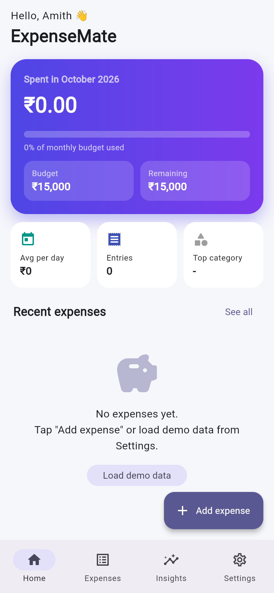 | 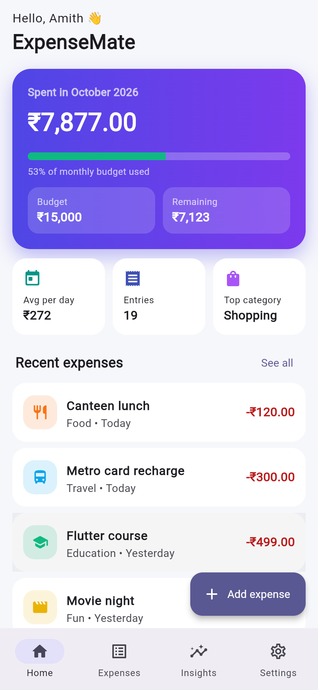 | 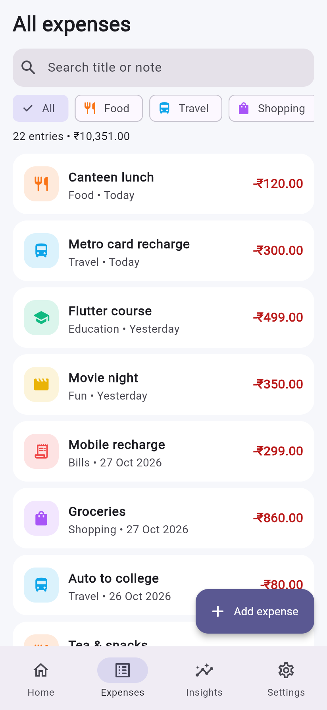 | 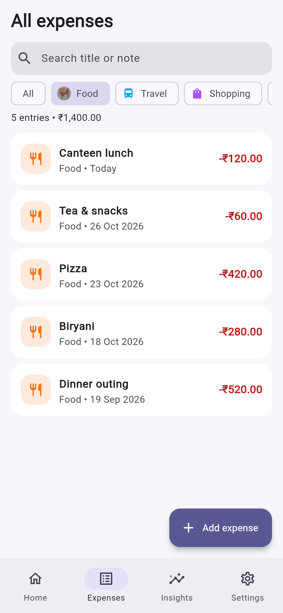 |

| Search | Add expense | Form validation | Expense saved |
|:---:|:---:|:---:|:---:|
| 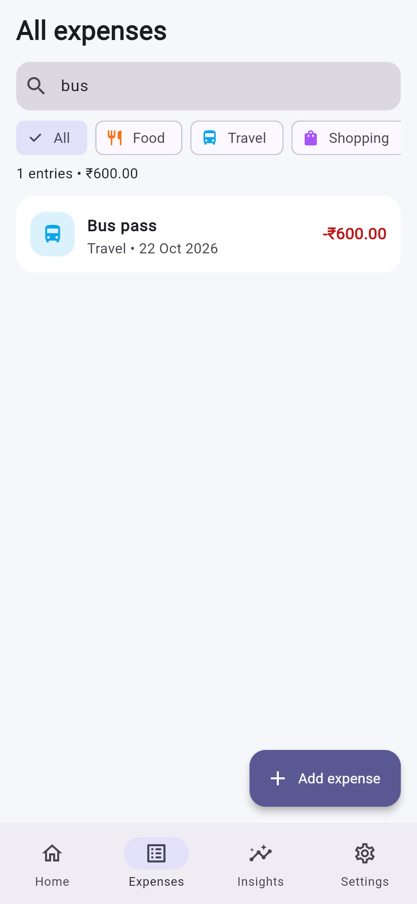 | 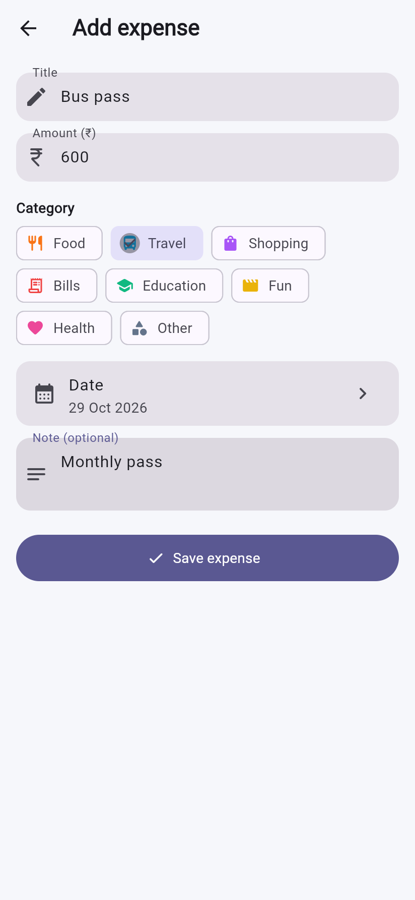 | 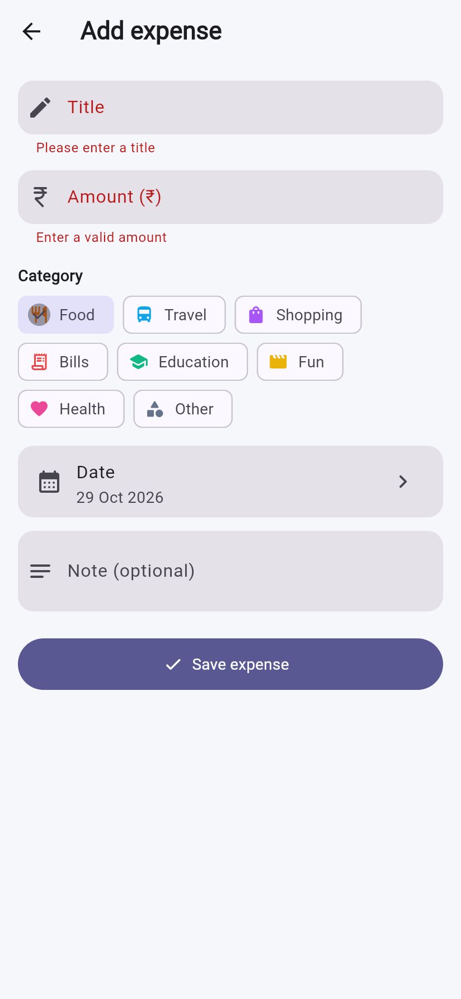 | 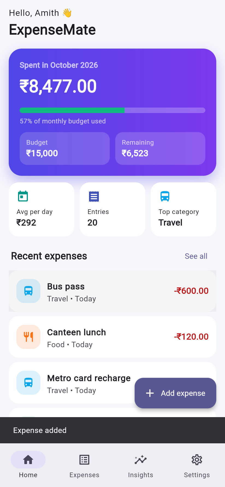 |

| Insights | Settings | Dark mode | Budget dialog |
|:---:|:---:|:---:|:---:|
| 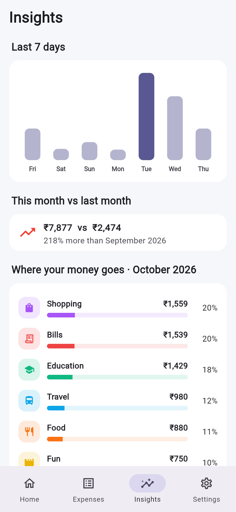 | 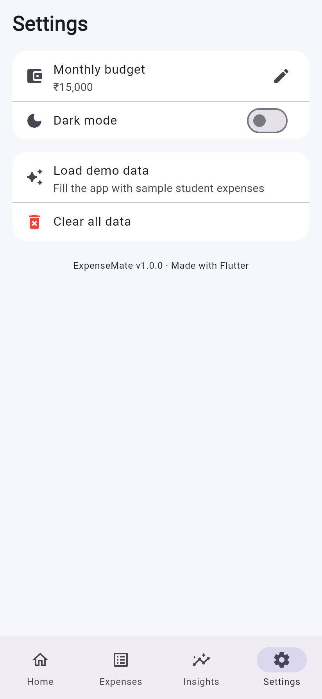 | 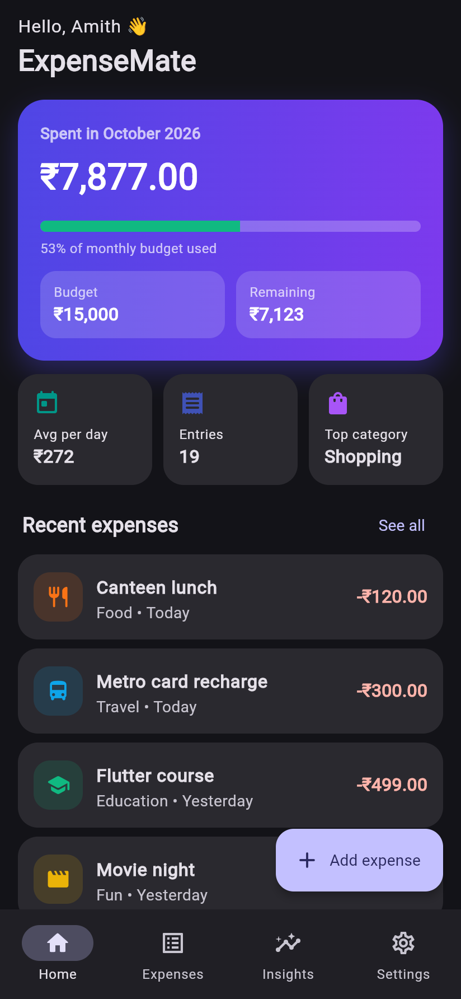 | 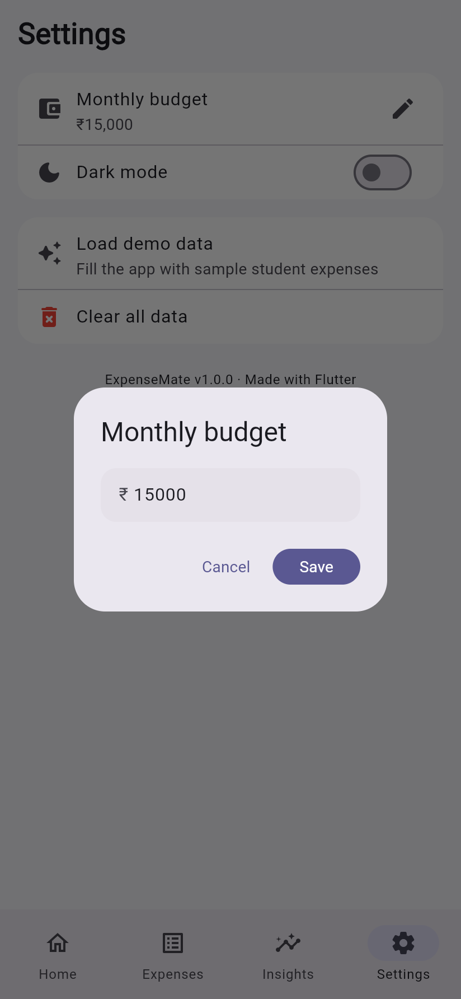 |

## 🖥️ Output

### Running the app
```text
$ flutter run -d web-server --web-port 8088 --release
Launching lib/main.dart on Web Server in release mode...
Compiling lib/main.dart for the Web...                             12.6s
✓ Built build/web
lib/main.dart is being served at http://127.0.0.1:8088
```
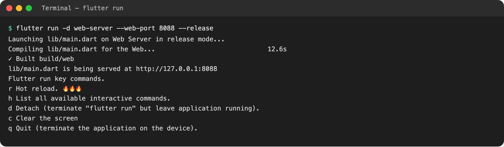

### Analyzer and tests
```text
$ flutter analyze
No issues found!

$ flutter test --reporter expanded
00:00 +0: test/utils_test.dart: Currency uses Indian digit grouping
00:00 +1: test/utils_test.dart: Currency compact labels
00:00 +2: test/utils_test.dart: Dates relative labels
00:00 +3: test/utils_test.dart: Validators title and amount
00:00 +4: test/widget_test.dart: user can add an expense from the dashboard
00:01 +5: test/widget_test.dart: validation errors are shown for an empty form
00:01 +6: test/controller_test.dart: add, update and remove expenses
00:01 +7: test/controller_test.dart: category totals are sorted from highest to lowest
00:02 +8: test/controller_test.dart: data is persisted and reloaded
00:02 +9: test/controller_test.dart: search filters by text and category
00:02 +10: test/expense_model_test.dart: Expense survives a JSON round trip
00:02 +11: test/expense_model_test.dart: Unknown category falls back to Other
00:02 +12: All tests passed!
```
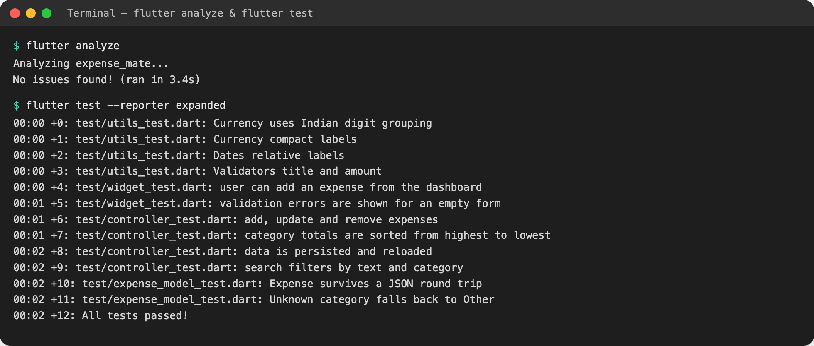

## 🏗️ Architecture

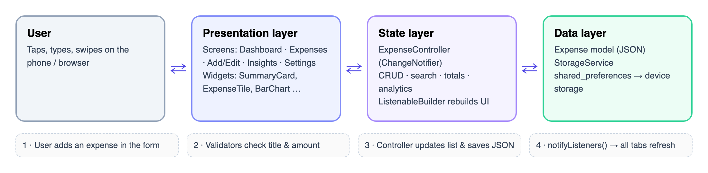

The app follows a simple three-layer design:

1. **Presentation** – screens and reusable widgets (`lib/screens`, `lib/widgets`).
2. **State** – `ExpenseController` (a `ChangeNotifier`) holds the list, does CRUD, search and analytics;
   screens rebuild with `ListenableBuilder`.
3. **Data** – the `Expense` model (JSON) and `StorageService`, which saves to the device with `shared_preferences`.

## 📁 Project structure

```text
lib/
├── main.dart                  # loads saved data, starts the app
├── app.dart                   # MaterialApp + light/dark theme switching
├── models/                    # Expense, ExpenseCategory
├── services/storage_service.dart
├── state/expense_controller.dart
├── data/sample_data.dart      # demo expenses
├── theme/                     # colours + Material 3 themes
├── utils/                     # currency (₹ Indian format), dates, validators
├── widgets/                   # summary card, tiles, bar chart, breakdown …
└── screens/                   # home shell, dashboard, expenses, add/edit, insights, settings
test/                          # 12 unit + widget tests
docs/                          # screenshots, architecture diagram, terminal output
```

## 🚀 Getting started

**Requirements:** Flutter 3.x (stable) · Dart 3.x · Chrome, an Android emulator or a phone

```bash
git clone https://github.com/Amith-Codez/ExpenseMate-Flutter.git
cd ExpenseMate-Flutter
flutter pub get
flutter run            # pick Chrome, Android or iOS
```

Run the checks:

```bash
flutter analyze
flutter test
```

Tip: open **Settings → Load demo data** to fill the app with sample student expenses.
